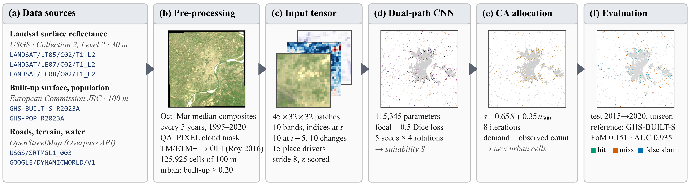

# Satellite-Based Urban Growth and Economic Activity Intelligence System

Choose an Indian city. The system finds and downloads the satellite, population and map data for
it, trains a deep-learning image model on that city's own history, tests the model on a period it
never saw, forecasts where the city will grow and where economic activity is rising, reads recent
development news, and ranks the places best suited for a company's new branch.

**Status (Review 4, October 2026):** the final dashboard is complete and has been run end to end
on **Bengaluru** and **Delhi**. It grew out of a research pipeline built on **Varanasi** in
Reviews 1 to 3, which is still here and is described further down.

| Start here | |
|---|---|
| [`docs/FINAL_DASHBOARD.md`](docs/FINAL_DASHBOARD.md) | The final dashboard: every stage, the data, the checks, the Bengaluru and Delhi results |
| [`docs/GUIDE_FINAL_PREVIEW.md`](docs/GUIDE_FINAL_PREVIEW.md) | The image model end to end, in plain English (Varanasi) |
| [`docs/figures/paper/`](docs/figures/paper/README.md) | Publication figures of the image model, with captions |

---

## The workflow



*The image model at the centre of every run, shown on Varanasi: data, preprocessing, the 45-channel
input, the network, the allocation of new urban cells, and the held-out evaluation.*

Open the dashboard, choose a city, press **Estimate** to see the data plan and the internet it
will use, then press **Run**. Each stage shows a progress bar, an x/N counter, the script that is
running, and the megabytes downloaded against the estimate.

| # | Stage | What happens |
|---|---|---|
| 1 | Resolving the city boundary | The city's boundary from OpenStreetMap, plus a 3 to 8 km growth belt, on a 100 m grid in the city's UTM zone |
| 2 | Looking for datasets | Counts clear Landsat scenes per year, lists the night-light years, counts roads and points of interest; writes the plan and the internet estimate |
| 3 | Downloading datasets | About 35 downloads from Earth Engine and OpenStreetMap, with every byte counted |
| 4 | Processing datasets | Every layer onto one 100 m grid |
| 5 | Training the image model | The Review 4 network (45 channels, 115,345 parameters), five seeds, trained on 2010-2015 |
| 6 | Evaluating on the held-out period | Scored once on 2015-2020 against random placement and logistic regression |
| 7 | Forecasting urban growth | New urban land by 2025, with how many seeds agree on each cell |
| 8 | Analysing economic activity | Night-light trend and a four-year growth forecast, tested on 2020-2024 |
| 9 | Fetching news information | Balanced queries to Google News and GDELT: developments and setbacks |
| 10 | Processing news information | A language model fills a fixed form for each article; a fixed table scores it |
| 11 | Scoring expansion opportunities | Five components per 500 m zone, checked under 2,000 random weightings |
| 12 | Displaying charts | Maps and charts in six result tabs |

The results open in six tabs: **Overview**, **Urban growth**, **Economic activity**, **News &
developments**, **Expansion opportunities**, and **Method & data**. The News tab maps each
development as a numbered badge with a circle for how far it reaches, says which top sites it moves
and by how much, and shows the ranking with and without news.

### Results

| | Bengaluru | Delhi |
|---|---|---|
| Study area | 2,139 km², 213,850 cells | 4,371 km², 437,100 cells |
| Image model, held-out 2015-2020 (Figure of Merit / AUC) | **0.176** / 0.931 | **0.222** / 0.964 |
| Logistic regression on the same drivers | 0.083 | 0.139 |
| Random placement | 0.016 | 0.011 |
| Forecast new urban land, 2020 to 2025 | 87.7 km² | 83.9 km² |
| Night-light growth forecast, tested on 2020-2024 (Spearman) | 0.66 | 0.33 |
| Top expansion sites | Gandhinagar, Sir MV Layout, Electronics City Phase 2 | Shipra Sun City (Ghaziabad), IFFCO Chowk (Gurugram), Ralpur Khadar (Noida) |
| News read by Gemini: developments on the map / citywide | 6 / 20 | 8 / 16 (2 more set aside as other places) |
| City news climate (-1 to +1) | +0.90 | +0.20 |
| Internet used | 41.7 MB | 112 MB, including a first run stopped by an OpenStreetMap server |

The Figure of Merit compares predicted and observed new urban cells: hits divided by hits, misses
and false alarms together. AUC (area under the ROC curve) measures how well the model ranks cells
that converted above cells that did not. The Delhi night-light forecast is weaker for a reason
explained in [`docs/FINAL_DASHBOARD.md`](docs/FINAL_DASHBOARD.md) §8: a 2016 drop that matches the
city's switch to LED street lights.

**Demo videos.** Timelapse recordings of both runs, with the clock, elapsed time and stage on every
frame, are in `data/cities/bengaluru/demo/` and `data/cities/delhi/demo/`. They are not in git.

---

## Quick start

**Requirements:** Python 3.11 or later, a free Earth Engine account (one-time
`earthengine authenticate`), and up to about 300 MB of disk per large city (Bengaluru 77 MB,
Delhi 258 MB). No GPU is needed. On a laptop CPU, training takes about 10 minutes for Bengaluru
and 22 for Delhi, and a full run takes 40 to 50 minutes. `run_final_dashboard.bat` is for Windows;
the Python commands work anywhere.

```bat
pip install -r requirements.txt -r requirements-dl.txt
earthengine authenticate
run_final_dashboard.bat
```

The dashboard opens at http://localhost:8501. The same run without the dashboard:

```bat
python -m urbanintel.city.run --city Delhi --estimate-only    :: data plan and internet estimate only
python -m urbanintel.city.run --city Delhi                    :: the full run
python -m urbanintel.city.run --city Delhi --from evaluate    :: keep data and trained seeds, redo the rest
python -m urbanintel.city.run --city Delhi --from news        :: redo only the news layer
python scripts/record_demo.py --city Delhi                    :: a timelapse video of a full run
python tests/test_city.py                                     :: tests for this part
```

The video recorder also needs the `playwright` Python package, Google Chrome and `ffmpeg` on the
PATH.

### The news reader (free)

The news layer uses a language model only to fill in a fixed form for each article. It picks a
reader by itself, and the default never costs money:

1. **The Gemini API free tier**, if you save a key. Create one at
   https://aistudio.google.com/apikey and, in your own terminal, run
   `setx GEMINI_API_KEY "your-key"`. The dashboard's **Refresh news only** button then re-reads the
   news without downloading or training again. If one Gemini model is busy or out of quota, the
   next free one is used; reading 140 articles takes about 12 minutes at the free-tier rate.
2. **A local model through Ollama** (qwen2.5:7b), if Ollama is running. This is free and offline,
   but weaker.

The Claude API can be chosen with `--llm claude`, but it is never chosen automatically.

### Internet use

Everything is measured, not guessed. The **Estimate** button shows the plan before anything is
downloaded. A city of about 2,000 km² uses roughly 40 to 50 MB, and Delhi-sized areas about 90 MB.
Earth Engine layers are cut to the city and averaged to 100 m on Google's servers, so a city needs
a few MB of Landsat instead of hundreds. Every download is cached, so a stopped run resumes without
fetching anything twice.

---

## What makes the results trustworthy

- **Three separate periods.** The model learns on 2010-2015, chooses its stopping point on
  2000-2005, and is scored once on 2015-2020. The periods never mix.
- **Baselines on the same test.** Random placement and logistic regression on the same drivers.
- **Checked data paths.** GHSL from the Earth Engine mirror is pixel-identical to the JRC bulk files
  the Varanasi model used. Landsat averaged on Earth Engine matches the local route (r ≥ 0.9997).
- **Economic activity is a proxy.** VIIRS (Visible Infrared Imaging Radiometer Suite) night-time
  radiance stands in for economic activity. In this project's own check, it tracks Uttar Pradesh
  district GDP with Spearman 0.85 across 71 districts. It is never presented as GDP.
- **Neutral news.** Political promises carry zero weight. Party names are removed from every
  output. Labels the article text does not support are set to neutral, by the same rule for good
  and bad news. A name-swap audit checks that the score does not change when party names are
  replaced. The news layer moves a zone's score by at most 0.10 on a 0 to 1 scale, and is shown
  separately from the satellite evidence.
- **Recommendations that do not depend on the weights.** Each top site reports the share of 2,000
  random weightings in which it stays in the top ten.

---

## Data

| Official identifier | Provider | Used for |
|---|---|---|
| `JRC/GHSL/P2023A/GHS_BUILT_S` (GHS-BUILT-S R2023A) | European Commission JRC | built-up surface 1995-2020, the labels |
| `JRC/GHSL/P2023A/GHS_POP` (GHS-POP R2023A) | European Commission JRC | population 1995-2020 |
| `LANDSAT/LT05/C02/T1_L2`, `LANDSAT/LE07/C02/T1_L2`, `LANDSAT/LC08/C02/T1_L2` | USGS | dry-season surface reflectance composites, 1995-2020 |
| `NOAA/VIIRS/DNB/ANNUAL_V21`, `NOAA/VIIRS/DNB/ANNUAL_V22` | NOAA / Colorado School of Mines | night-time radiance 2013-2025, an economic-activity proxy |
| `GOOGLE/DYNAMICWORLD/V1` | Google and World Resources Institute | water, for distance to water |
| `USGS/SRTMGL1_003` | NASA / USGS | terrain slope |
| OpenStreetMap (Overpass API; ohsome API for counts) | OpenStreetMap contributors | roads and points of interest |
| Google News RSS, GDELT DOC 2.0 | publishers, via Google News and the GDELT Project | headlines and snippets for the news layer |

The Varanasi research pipeline also uses `COPERNICUS/S2_SR_HARMONIZED`, `LANDSAT/LC09/C02/T1_L2`,
`MODIS/061/MOD11A2`, `ESA/WorldCover/v200`, `GOOGLE/Research/open-buildings-temporal/v1`,
`WorldPop/GP/100m/pop`, the Census of India, and SHRUG. See [`docs/DATASETS.md`](docs/DATASETS.md).

---

## The Varanasi research pipeline (Reviews 1 to 4)

The final dashboard is built on this work, and all of it still runs.

**Analytical layers** (`python -m urbanintel.pipeline`, or `run_review3.bat` for the whole chain):

1. **Built-up expansion.** GHS-BUILT-S differenced across 2010, 2015 and 2020, classified as infill,
   edge expansion or leapfrog (Liu et al. 2010).
2. **Economic activity.** VIIRS radiance and its trend, plus OpenStreetMap commercial points of
   interest, normalised per unit of built-up area.
3. **Green cover loss.** NDVI (Normalized Difference Vegetation Index) change from Sentinel-2,
   intersected with Dynamic World built-up gain over the same years.
4. **Urban heat island.** Landsat land surface temperature minus a rural reference that excludes
   water and recently built land.
5. **Ghost growth.** New development whose activity is far below what this city shows for the same
   built-up intensity, separated from neighbourhoods that are still filling up. It has six
   classes: `ghost_growth`, `emerging`, `healthy_growth`, `established_active`, `declining` and
   `undeveloped`. This is a screening tool, not an occupancy census.
6. **Growth prediction.** Logistic regression and random forest (Review 3, Figure of Merit 0.103),
   then the image model (Review 4).

**The image model** (`scripts/train_image_v2.py`) is a small two-path convolutional network that
reads Landsat imagery and 15 place features together. Its five-seed ensemble scores a Figure of
Merit of **0.1507** (AUC 0.935) on Varanasi's held-out 2015-2020, against 0.103 for the Review 3
random forest. The final dashboard runs exactly this trainer on every city.

```bat
python scripts/export_landsat_stack.py --years 1990 1995 2000 2005 2010 2015 --ghsl
python -m urbanintel.pipeline
python scripts/train_image_v2.py --factor 1 --with-drivers --stop-on 2000 --epochs 250 ^
       --patience 40 --steps 20 --widths 16 32 --dropout 0.5 --seed 0 --tag v5_s0
python scripts/make_paper_figures.py
```

`run_dashboard.bat` opens the Review 3 dashboard for Varanasi.

---

## Documentation

| Document | What it covers |
|---|---|
| [`FINAL_DASHBOARD.md`](docs/FINAL_DASHBOARD.md) | **The final system.** Stages, data, checks, problems met, Bengaluru and Delhi results |
| [`GUIDE_FINAL_PREVIEW.md`](docs/GUIDE_FINAL_PREVIEW.md) | The image model end to end, with figures and a per-layer table |
| [`figures/paper/`](docs/figures/paper/README.md) | Four publication figures (PDF, SVG, PNG) with captions |
| [`DEEP_MODELS.md`](docs/DEEP_MODELS.md) | The running record of every deep model tried, with dates and results |
| [`REVIEW3_REPORT.md`](docs/REVIEW3_REPORT.md) | Review 3: implementation, results, validation, corrections log |
| [`METHODOLOGY.md`](docs/METHODOLOGY.md), [`METHODOLOGY_SIMPLE.md`](docs/METHODOLOGY_SIMPLE.md) | The full method, and a short version |
| [`WORKFLOW.md`](docs/WORKFLOW.md), [`DESIGN.md`](docs/DESIGN.md) | The Varanasi pipeline stages and how the system is put together |
| [`DATASETS.md`](docs/DATASETS.md) | Every dataset, why it is used, and what is deliberately not used |
| [`DIAGRAMS.md`](docs/DIAGRAMS.md) | Architecture diagrams and progress charts |
| [`LITERATURE_REVIEW.md`](docs/LITERATURE_REVIEW.md), [`PAPER_SUMMARIES.md`](docs/PAPER_SUMMARIES.md) | The literature behind the method |
| [`CONVENTIONS.md`](docs/CONVENTIONS.md) | Abbreviations, official dataset identifiers, writing rules |
| [`SETUP.md`](docs/SETUP.md), [`DATA_TRANSFER.md`](docs/DATA_TRANSFER.md) | Installation, Earth Engine, moving the data between machines |
| [`CONTRIBUTIONS.md`](CONTRIBUTIONS.md) | Who built what, and project contributor roles |

---

## Repository layout

```
run_final_dashboard.bat         the final dashboard
dashboard/final_app.py          the final dashboard (Streamlit): city picker, live progress, six result tabs
dashboard/app.py                the Review 3 dashboard for Varanasi
config/varanasi.yaml            the template every city's configuration is generated from
src/urbanintel/
  city/                         the final system, one city end to end
    catalog.py                  city search, study area, UTM zone, per-city configuration
    fetch.py                    every download, byte-metered and cached; the internet estimate
    prepare.py                  every layer onto the 100 m grid
    model.py                    runs the image-model trainer, evaluates, forecasts 2025
    economy.py                  night-light trend and the four-year growth forecast
    news.py, llm.py             news retrieval, the fixed form, scoring, neutrality audit
    opportunity.py              expansion score and its robustness
    charts.py                   map layers for the dashboard
    progress.py, run.py         live status for the dashboard; the orchestrator
  deep/                         the image model: features, stacks, tiles, network, training
  data/                         GHSL, Landsat, Earth Engine, OpenStreetMap, SHRUG, WorldPop
  analysis/                     built-up change, night lights, vegetation, heat, ghost growth, growth models
  pipeline.py                   the Varanasi pipeline
scripts/
  train_image_v2.py             the image-model trainer (used by every city)
  record_demo.py                timelapse video of a dashboard run
  make_paper_figures.py         the four publication figures
  export_landsat_stack.py       Landsat composites for Varanasi
  run_growth_model.py, run_deep_system.py, validate_*.py, cross_checks.py, make_figures.py
tests/
  test_core.py                  41 tests: the Varanasi pipeline
  test_deep.py                  16 tests: the deep models
  test_city.py                  23 tests: the final system
data/                           (gitignored) downloads, rasters, models; data/cities/<city>/ per city
```

---

## Design decisions worth knowing

- **One model design for every city, trained on that city.** There is no transfer from Varanasi
  and no per-city tuning, so a city's score measures the method, not adjustments made for it.
- **Two grids.** Analysis runs at 100 m, the GHSL resolution, to keep change detection sharp.
  Economic activity and opportunities are scored on 500 m zones, close to the VIIRS pixel, so the
  results do not claim detail the sensor does not have.
- **Density-preserving reprojection.** Built-up area and population are totals per cell, so they
  are converted to density, reprojected from Mollweide to UTM, and rescaled. Totals survive the
  change of grid.
- **A dry-season window per city.** October to March suits north India, but October and November
  are monsoon months in Bengaluru. Each city uses the window with the most clear Landsat scenes, the
  same for every year.
- **The chart palette is validated, not chosen by eye.** Colours are checked for colour-blind
  readers. Red is reserved for errors, which is why "healthy" is blue.

---

## Literature

Method choices are grounded in [`RECOMMENDED_PAPERS.md`](RECOMMENDED_PAPERS.md) and
[`docs/LITERATURE_NTL_AND_UNET.md`](docs/LITERATURE_NTL_AND_UNET.md). The load-bearing references:

- Jin et al. 2017, *Applied Geography* 80:112: multi-source ghost-city identification
- Liu et al. 2010, *Landscape and Urban Planning*: landscape expansion index (urban form)
- Henderson, Storeygard & Weil 2012, *AER* 102:994: what night lights can and cannot say about output
- Roy et al. 2016, *Remote Sensing of Environment*: harmonising Landsat 5/7 with Landsat 8
- Pontius & Si 2014: the Total Operating Characteristic and the Figure of Merit
- Lin et al. 2017: focal loss for rare positives

---

## Licence and data terms

Code: for academic use. Data: GHSL (CC BY 4.0), OpenStreetMap (ODbL, attribution required),
Landsat and VIIRS (US public domain), Copernicus/Sentinel (open), Dynamic World and Open Buildings
(CC BY 4.0). The news layer reads public headlines and snippets and stores no article text. Content
sent to the Gemini free tier may be used by Google to improve its products, so only public headlines
are sent. Use of AI assistance in this project is acknowledged in
[`CONTRIBUTIONS.md`](CONTRIBUTIONS.md).
